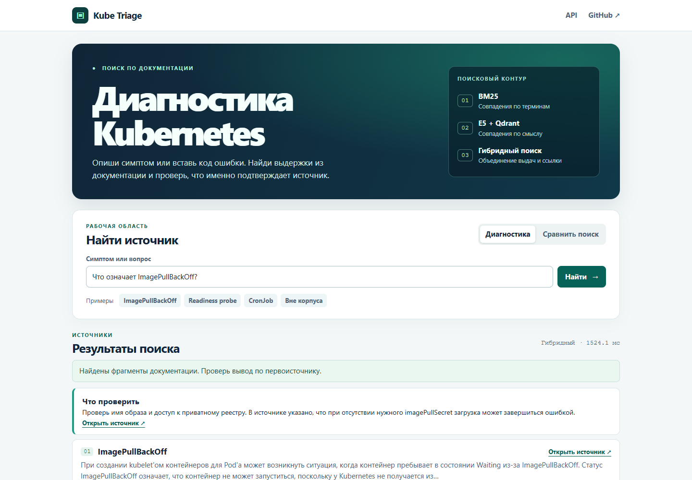
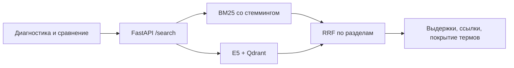

# Kube Triage

**Диагностика Kubernetes по русскоязычной документации.** Введи симптом или код ошибки, открой точные строки источника и сравни, как BM25, E5 и гибридный поиск ранжируют разделы.

**16/16 попаданий в топ‑5 · MRR@5 0,969 · 0/24 выдач с повторами разделов** на новом тестовом наборе.

[Смотреть демо](docs/media/kube-triage-demo.mp4) · [Отчёт об оценке](docs/evaluation.md) · [Первая версия и ранние эксперименты](docs/initial-experiments.md)



## Быстрый запуск

Нужен Docker Engine с Compose. Из корня репозитория:

```bash
docker compose up --build -d --wait --wait-timeout 600
```

Открой [Kube Triage](http://127.0.0.1:8000/) и выбери **ImagePullBackOff**. Ключ для поиска не нужен. Первый запуск скачивает закреплённую версию E5 и строит индекс. Модель и индекс сохраняются в отдельных именованных томах.

- **Диагностика** показывает выдержки, ссылки на строки документации и предупреждение, когда термы запроса слабо подтверждаются найденными фрагментами.
- **Сравнить поиск** ставит рядом BM25, E5 + Qdrant и гибрид. На примере **CronJob** показывает позицию эталонного раздела для каждого варианта.
- **API** доступен в [Swagger](http://127.0.0.1:8000/docs). `/search` отдаёт результаты поиска, `/health` показывает готовность, `/ask` подключает генерацию при наличии настроек Yandex AI Studio. Демо и оценка поиска используют `/search`.

## Что измерили

На новом тестовом наборе **RRF по разделам** сохранил **16/16** попаданий в топ‑5, поднял MRR@5 с **0,938 до 0,969** и убрал повторы разделов **с 9/24 до 0/24** относительно RRF по фрагментам. Индикатор нехватки источников сработал для **6/8** вопросов вне корпуса и для **1/16** вопросов с ответом. Подробности и ограничения приведены в [отчёте](docs/evaluation.md).



## Проверки

```bash
python -m pip install -r requirements-dev.txt
python scripts/build_corpus.py
python -m pytest -q
python scripts/smoke_demo.py
```

CI запускает тесты, собирает корпус и проверяет страницу, здоровье контейнера и источник в ответе BM25. Для запуска тестов локально используется Python 3.14. Команда `smoke_demo.py` рассчитана на запущенный экземпляр без настроек LLM.

Десять страниц русскоязычной документации закреплены в `data/sources.json`. Материалы Kubernetes распространяются по [CC BY 4.0](https://creativecommons.org/licenses/by/4.0/), копия лицензии есть в [репозитории](data/LICENSE-kubernetes.txt).
