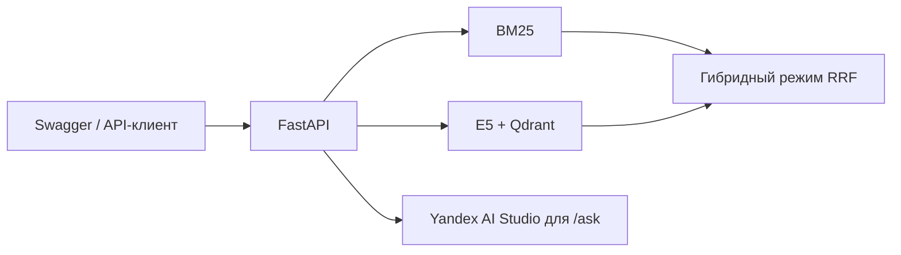

# RAG-ассистент по документации Kubernetes

Портфолио-проект по поиску и ответам с источниками на русском языке. FastAPI принимает запросы, Qdrant хранит векторный индекс, а Docker Compose запускает оба сервиса. После нормализации русских словоформ гибридный поиск нашёл нужный раздел в топ‑5 в 19 случаях из 20 на повторном прогоне.

[Смотреть демо (MP4, 32 с)](docs/media/kubernetes-rag-demo.mp4) · Запрос к `/search` в Swagger, результат гибридного поиска и ссылка на документацию Kubernetes.

## Быстрый запуск

Нужен запущенный Docker Engine с Compose. Из корня репозитория:

```bash
docker compose up --build -d --wait --wait-timeout 600
docker compose ps
```

Открой [Swagger UI](http://127.0.0.1:8000/docs) и вызови `POST /search`. Для `POST /ask` один раз скопируй `.env.example` в `.env`, заполни `LLM_API_KEY` и `LLM_FOLDER_ID`, затем повтори `docker compose up -d --wait`. На первом запуске скачивается модель эмбеддингов.



## Этап 1. Корпус и вопросы

В корпус входят десять русскоязычных материалов Kubernetes о пробах, ресурсах CPU и памяти, CronJob, DaemonSet, образах, селекторах, пространствах имён и хуках контейнеров. Набор ограничен этими страницами, поэтому ответы следует оценивать относительно закреплённого снимка. В примерах upstream могут встречаться версии API и команды, рассчитанные на другие версии Kubernetes.

Исходники находятся в `data/raw/`. В `data/sources.json` зафиксированы пути и коммит upstream. При подготовке корпуса скрипт убирает YAML-шапку и служебную разметку Hugo, группирует абзацы в пределах раздела и сохраняет блоки кода целиком. Внешние материалы, подключаемые шорткодами, в корпус не входят.

## Сборка корпуса

Требуется Python 3.10 или новее. Команды запускаются из корня репозитория. На Windows вместо `python` можно использовать `py -3`.

```bash
python scripts/build_corpus.py
```

Скрипт создаёт `data/processed/chunks.jsonl` из локальных исходников. Сеть и ключ API для этого не нужны. У каждого фрагмента есть UUID, идентификатор раздела, иерархия заголовков, версия документации и ссылка на диапазон строк в GitHub на закреплённом коммите. Целевой размер фрагмента — до 1 400 символов. Отдельный длинный абзац или блок кода может превышать этот размер.

## Набор для оценки

| Набор | С ответом | Без ответа | Всего |
| --- | ---: | ---: | ---: |
| `evaluation/dev.jsonl` | 25 | 9 | 34 |
| `evaluation/test.jsonl` | 20 | 6 | 26 |

`dev` используется для выбора настроек, `test` — для итогового прогона. Связанные формулировки одного намерения должны находиться в одном наборе.

У каждого вопроса есть `id`, текст, тип (`exact`, `semantic` или `unanswerable`) и группа по намерению (`group`). Для вопроса с ответом указаны `relevant_section_ids` и краткий `reference_answer`. У вопроса без ответа список разделов пуст, а эталонный ответ равен `null`. Наличие ответа оценивается по десяти исходникам, включая текст внутри блоков кода.

Поисковую оценку считаем по уникальным разделам: несколько найденных фрагментов одного раздела дают одно попадание. При оценке генерации отдельно проверим, содержит ли процитированный фрагмент нужное утверждение.

## Этап 2. Поиск

`bm25` ищет по словам и сохраняет точные термины вроде `--field-selector`. `numpy` — базовый векторный поиск, `qdrant` использует те же эмбеддинги в отдельном сервисе, а `hybrid` объединяет списки BM25 и Qdrant через RRF. Для E5 используются префиксы `query:` и `passage:` и нормализованные векторы. Ревизия модели зафиксирована в коде.

Для поиска нужны Python 3.14, проверенный на Windows x86-64, и зависимости из `requirements.txt`. Для запуска Qdrant по инструкции ниже нужен работающий Docker Engine с Compose. Для первого скачивания модели нужен интернет. Ключ LLM на этом этапе не используется.

```powershell
py -3.14 -m venv .venv
$env:HF_HOME = Join-Path (Get-Location) '.venv/hf'
.\.venv\Scripts\python.exe -m pip install -r requirements.txt
.\.venv\Scripts\python.exe scripts/build_corpus.py
docker compose up -d qdrant
.\.venv\Scripts\python.exe -m unittest discover -s tests -v
.\.venv\Scripts\python.exe -m scripts.search 'Что означает ImagePullBackOff?' --document-id images --limit 3
.\.venv\Scripts\python.exe -m scripts.evaluate_search --split dev
```

Compose поднимает Qdrant на `127.0.0.1:6333` и хранит индекс в именованном томе. Коллекция привязана к содержимому корпуса и ревизии модели. Повторный запуск использует уже заполненную коллекцию. Для выбора другого адреса есть `--qdrant-url`. Без сервера можно сравнить базовые методы с `--modes bm25 numpy` или использовать встроенный режим клиента Qdrant с `--qdrant-url ':memory:'`. Во встроенном режиме коллекция создаётся заново при каждом запуске.

Оценка берёт до 20 фрагментов, оставляет пять первых уникальных разделов и считает Recall@5 и MRR@5 на вопросах с ответом. Время поиска измеряется на всех вопросах после прогрева и включает вычисление эмбеддинга запроса для векторных режимов. Детали по каждому вопросу сохраняются в `data/processed/dev-search-results.json`.

### Результаты на dev

Один прогон на CPU под Windows с нативным Qdrant 1.20.0. Оценка качества рассчитана по 25 вопросам с ответом. Средняя задержка показывает время в этом прогоне и зависит от окружения.

| Режим | Recall@5 | MRR@5 | Средняя задержка |
| --- | ---: | ---: | ---: |
| BM25 | 0,920 | 0,807 | 0,5 мс |
| NumPy + E5 | 0,960 | 0,890 | 36,6 мс |
| Qdrant + E5 | 0,960 | 0,890 | 57,4 мс |
| BM25 + Qdrant через RRF | 0,960 | 0,853 | 52,4 мс |

В исходной версии режимом по умолчанию был **Qdrant + E5**: на `dev` у него был наибольший MRR@5. Исходный гибридный режим нашёл нужный раздел для вопроса о TCP-проверке (`q003`), который пропустил векторный поиск, но пропустил раздел о дедлайне запуска CronJob (`q017`).

Два из 134 фрагментов длиннее окна E5 в 512 токенов. Векторный индекс учитывает их начало, а BM25 и выдача сохраняют полный текст.

## Этап 3. HTTP API и ответы с источниками

Запуск FastAPI в PowerShell из корня репозитория. Сначала подготовь корпус. Для первого запуска без отдельного сервера Qdrant можно использовать встроенный режим клиента:

```powershell
$env:HF_HOME = Join-Path (Get-Location) '.venv/hf'
$env:QDRANT_URL = ':memory:'
.\.venv\Scripts\python.exe -m uvicorn app.api:app --host 127.0.0.1 --port 8000
```

Чтобы запустить API с отдельным Qdrant, запусти `docker compose up -d qdrant` и задай `$env:QDRANT_URL = 'http://127.0.0.1:6333'` перед запуском Uvicorn. Для быстрого демо только с BM25 задай `$env:SEARCH_MODES = 'bm25'` перед запуском. Этот режим обходится без Qdrant и загрузки E5.

Открой [Swagger UI](http://127.0.0.1:8000/docs). В `POST /search` и `POST /ask` можно передать одинаковый запрос:

```json
{"question": "Что означает ImagePullBackOff?", "document_id": "images", "limit": 5}
```

- `GET /health` показывает готовность индекса, доступные режимы поиска и наличие настроек LLM. При недоступном индексе возвращает HTTP 503.
- `POST /search` возвращает найденные фрагменты и работает без ключа LLM. Можно явно выбрать `mode` и отфильтровать источники по `document_id` или `version`.
- `POST /ask` передаёт вопрос и найденные фрагменты модели. В ответ попадают ссылки на фрагменты из этого запроса. При отсутствии фрагментов или отказе модели по недостатку сведений возвращается `insufficient_evidence`. Фактическую опору ответа на процитированный текст оцениваем отдельно.
- Ошибки LLM имеют отдельные коды. HTTP 503 означает отсутствие конфигурации, HTTP 504 — таймаут, HTTP 502 — ошибку провайдера или некорректный ответ.

Для генерации скопируй `.env.example` в `.env`, заполни `LLM_API_KEY` и `LLM_FOLDER_ID`, затем перезапусти API. Переменные окружения имеют приоритет над `.env`. Модель по умолчанию — `yandexgpt/rc`, с выводом по JSON Schema. Тесты используют подмену HTTP-ответа провайдера, а для запроса к реальной модели нужны действующие настройки. [Настройка доступа и пример запроса в Yandex AI Studio](https://aistudio.yandex.ru/ru/docs/ai-studio/operations/generation/completions-structured)

Для запуска всех тестов:

```powershell
.\.venv\Scripts\python.exe -m pip install -r requirements-dev.txt
.\.venv\Scripts\python.exe -m pytest -q
```

## Этап 4. Docker и итоговая оценка

`Dockerfile` устанавливает зависимости CPU и собирает корпус при сборке образа. Приложение работает от непривилегированного пользователя. Compose ждёт готовности Qdrant, а проверка здоровья приложения обращается к `/health`. Индекс Qdrant и файлы E5 сохраняются в отдельных именованных томах. Compose читает настройки LLM при запуске. Локальный `.env` исключён из Git и из контекста сборки Docker.

На Windows с Docker Engine в WSL 2 проверен запуск из чистого локального клона. После `down` контейнер Qdrant поднялся отдельно от приложения и восстановил все 134 точки из тома.

### Сценарий демо

1. Собери и запусти сервис командами из раздела «Быстрый запуск». Покажи состояние контейнеров и открой `/health`.
2. В Swagger отправь запрос «Что означает ImagePullBackOff?» через `/search` и покажи фрагмент с исходной ссылкой. Вопрос «Сможет ли планировщик разместить Pod, если запрошенный объём ОЗУ не помещается ни на одном узле?» подходит для сравнения BM25 и векторного поиска.
3. С настроенной LLM задай через `/ask` вопрос про `ImagePullBackOff`, затем «Как откатить релиз Helm на предыдущую ревизию?». Во втором случае ожидается `insufficient_evidence`, поскольку выбранный корпус не покрывает этот вопрос.
4. Покажи логи и повторный старт. После `docker compose down` обычный `up` поднимет сервис с сохранёнными томами.

```bash
docker compose logs --tail 40 app qdrant
docker compose restart app
docker compose up -d --wait
docker compose exec -T app python -m scripts.evaluate_search --split test --qdrant-url http://qdrant:6333
```

Чтобы выгрузить детали поиска из контейнера, выполни `docker compose cp app:/app/data/processed/test-search-results.json ./test-search-results.json`. Если меняешь `.env`, пересоздай приложение через `docker compose up -d --wait`, чтобы Compose передал новые значения.

### Исходные результаты на test

На 20 вопросах с ответом. Ещё 6 вопросов без ответа предназначены для оценки отказов генерации. Recall@5 и MRR@5 совпали при локальном прогоне Windows и запуске скрипта внутри Docker.

| Режим | Recall@5 | MRR@5 | Средняя задержка на CPU Windows |
| --- | ---: | ---: | ---: |
| BM25 | 0,750 | 0,564 | 1,0 мс |
| NumPy + E5 | 0,700 | 0,592 | 45,1 мс |
| Qdrant + E5 | 0,700 | 0,592 | 45,0 мс |
| BM25 + Qdrant через RRF | 0,900 | 0,710 | 43,2 мс |

Гибридный поиск поднял в топ‑5 раздел про readiness-пробы (`q005`), который пропустил E5, и раздел про ограничение CPU (`q010`), который пропустил BM25. Все режимы пропустили нужные разделы для замены активной задачи CronJob (`q018`) и списка типов ресурсов без namespace (`q042`).

### Оптимизация русскоязычного поиска

BM25 сводит русские словоформы к общей основе через Snowball. Например, «контейнер», «контейнера» и «контейнером» дают один поисковый токен. Написание технических флагов и полей сохраняется. Конфигурацию выбрали по `dev` и затем повторно проверили на тех же отложенных вопросах. [Алгоритм Snowball для русского языка](https://snowballstem.org/algorithms/russian/stemmer.html)

| Режим | Топ‑5 на dev, до → после | Топ‑5 на test, до → после | MRR@5 на test, до → после |
| --- | ---: | ---: | ---: |
| BM25 | 23/25 → 24/25 | 15/20 → 18/20 | 0,564 → 0,742 |
| E5 + Qdrant | 24/25 → 24/25 | 14/20 → 14/20 | 0,592 → 0,592 |
| Гибридный | 24/25 → 25/25 | 18/20 → 19/20 | 0,710 → 0,756 |

По умолчанию включён гибридный режим: на `dev` он дал максимальное число попаданий в топ‑5. Средняя обратная позиция на `dev` изменилась с 0,853 до 0,847. Единственный промах гибридного поиска на повторном `test` — вопрос про замену активной задачи CronJob (`q018`). Набор `test` уже использовался в предыдущем прогоне, поэтому это сравнение версий на одном наборе.

### Оценка генерации

Для прогона по 26 вопросам заполни локальный `.env` и пересоздай приложение. Команда сохраняет ответы, источники и задержку, считает корректные и ложные отказы. При сбое повторный запуск продолжит с первого вопроса без сохранённого результата. При смене модели или настроек используй новый файл через `--output`.

```bash
docker compose exec -T app python -m scripts.evaluate_answers
docker compose cp app:/app/data/processed/test-answer-results.jsonl ./test-answer-results.jsonl
```

При ручной проверке сравни `answer` с `reference_answer` и проверь, подтверждают ли возвращённые фрагменты ключевые утверждения. Живой прогон Yandex AI Studio ещё предстоит после настройки доступа.

## Источник и атрибуция

Материалы в `data/raw/` взяты из [официального репозитория документации Kubernetes](https://github.com/kubernetes/website/tree/14783102c018b7a79d99462fb6cdbd5473f157d6/content/ru/docs). Авторы — участники проекта Kubernetes. Материалы распространяются по [CC BY 4.0](https://creativecommons.org/licenses/by/4.0/), копия лицензии находится в `data/LICENSE-kubernetes.txt`. Исходные файлы сохранены без изменений. Производные фрагменты содержат описанные выше изменения разметки и ссылки на исходник.
